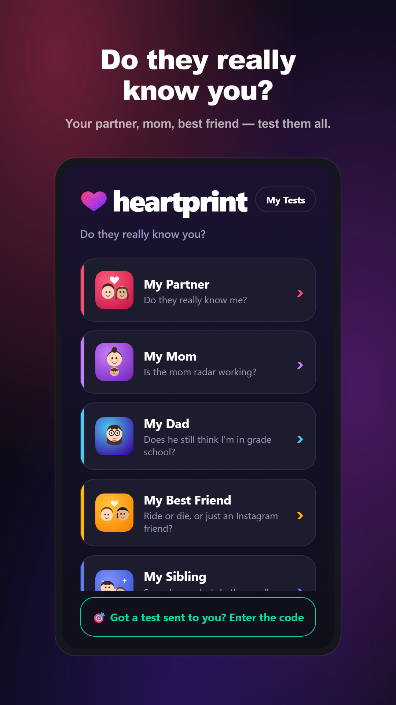
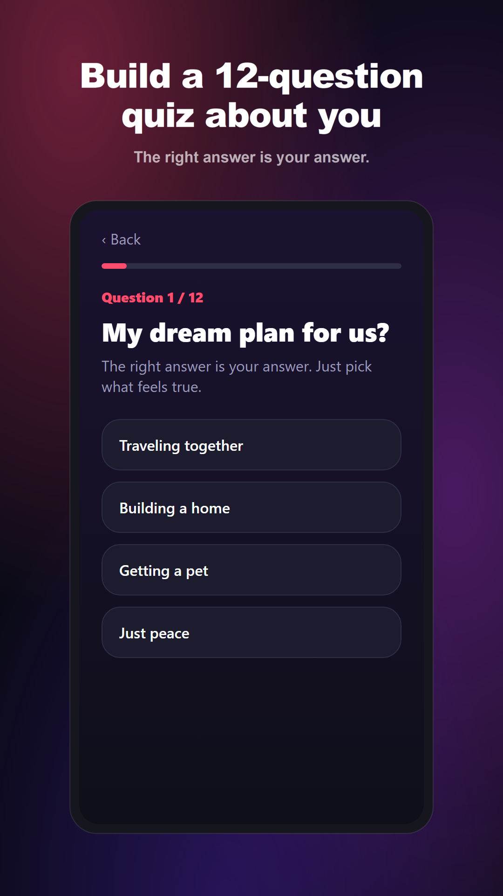
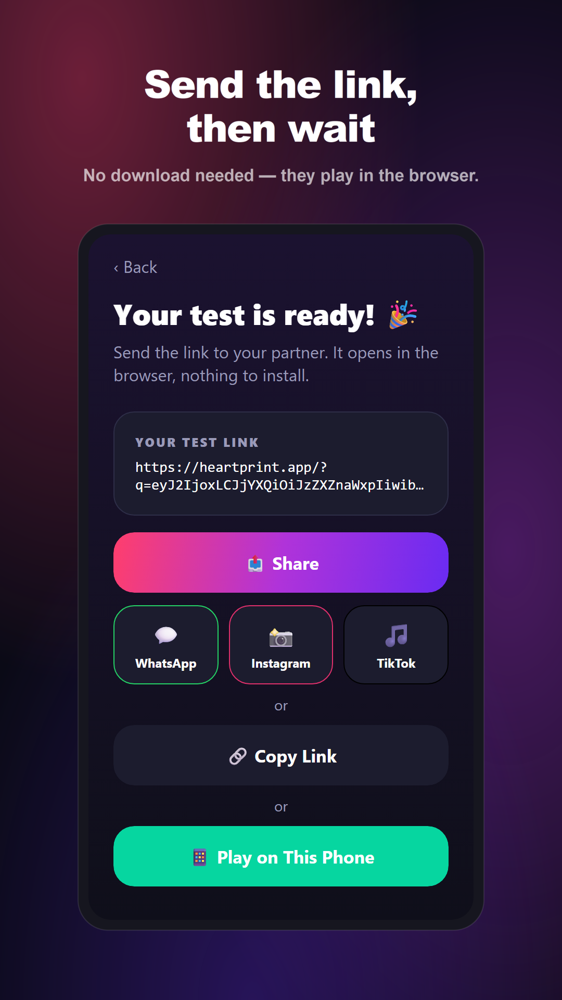
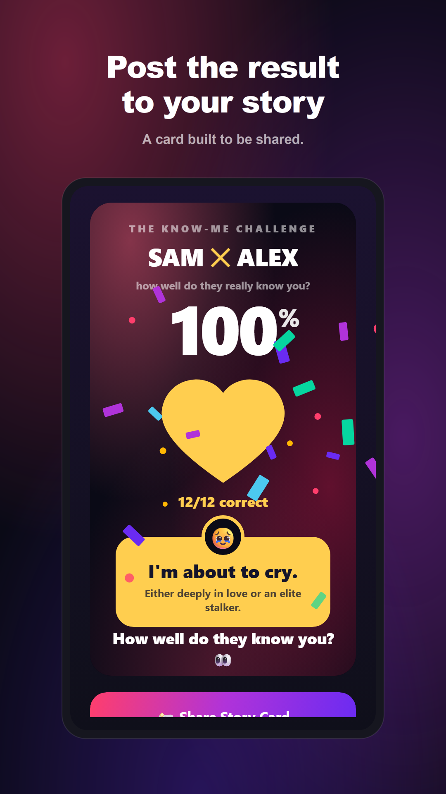
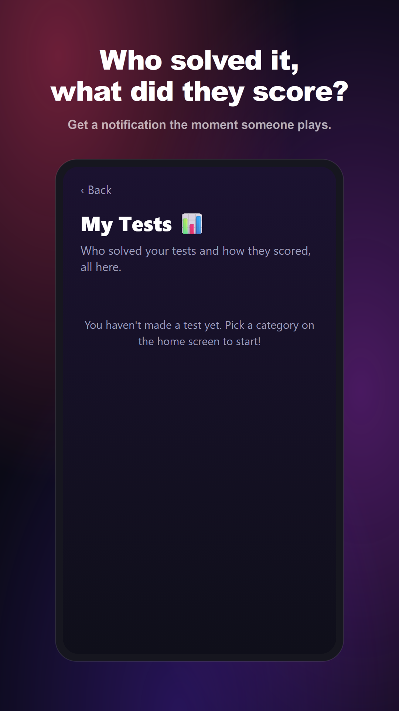

<div align="center">


# Heartprint

**How well do your people really know you?**

Create a quick test about yourself, send it with a code, and get a funny, shareable result card.

[](https://expo.dev)
[](https://reactnative.dev)
[](https://www.typescriptlang.org)
[](https://firebase.google.com)

[Web version](https://heartprint-green.vercel.app)







</div>

## How it works

1. **Pick a category:** partner, mom, dad, best friend, ex, or anonymous.
2. **Answer 12 short questions** about yourself (about a minute).
3. **Share your test** with a code over WhatsApp or Instagram.
4. **They play,** and both of you see how well they really know you.

Every result ends with a stylish, share-ready card made for Stories.

## Tech stack

| Layer | Tools |
|---|---|
| App | Expo SDK 57, React Native 0.86, React 19, TypeScript |
| Backend | Firebase (Firestore, Cloud Functions) |
| Monetization | Google Mobile Ads (interstitial and rewarded) |
| Web | Expo web build, deployed on Vercel |

## Project structure

```
src/
  screens/     Home, CreateQuiz, PlayQuiz, Result, Share, MyTests, EnterCode
  components/  Shared UI
  backend/     Firebase, quizzes, analytics, notifications
  ads/         Ad placement logic
  i18n/        Translations and locale detection
functions/     Firebase Cloud Functions
store/         Store listing copy, screenshots and setup guides
```

## Getting started

```bash
npm install
npx expo start
```

Ads only show in a development or production build (EAS), not in Expo Go or on the web.
Setup guides for Firebase, AdMob and the Play Store are in [`store/`](store/).

## License

[MIT](LICENSE)
